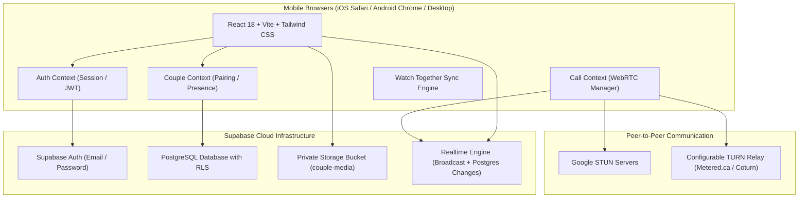

# Just You & Me 💗 — A Private Couples Communication Website

> A private, intimate, modern romantic web sanctuary built exclusively for two people in a relationship. Accessible from any modern mobile browser (iOS Safari, Android Chrome) or desktop without needing app store installations.

---

## 🌟 Key Features Overview

| Feature | Description | Status |
| :--- | :--- | :--- |
| **Private Couple Pairing** | 1-to-1 invitation system with expiring codes and a hard database trigger locking the space to exactly 2 partners. Unauthorized third parties are completely blocked. | ✅ Complete |
| **Realtime Private Chat** | Live messaging with timestamps, date separators, reply-to quotes, edit/delete options, and instant heart bursts with confetti. | ✅ Complete |
| **Private Photos & Videos** | Media sharing stored in private Supabase Storage buckets, secured by RLS, rendered via short-lived signed URLs, and viewed in a full-screen lightbox. | ✅ Complete |
| **Voice Messages** | In-chat voice note recording with timer, live waveform animation, cancel/send controls, and cross-browser codec fallback (WebM, MP4, OGG). | ✅ Complete |
| **Romantic Stickers & GIFs** | Integrated search via Tenor / GIPHY with an extensive built-in curated collection of animated romantic stickers and love badges that work out of the box. | ✅ Complete |
| **WebRTC Audio & Video Calling** | Real 1-to-1 voice and video calling via WebRTC with Supabase Realtime broadcast signaling, synthesized Web Audio ringtones, camera flipping, and STUN/TURN support. | ✅ Complete |
| **Synchronized Movie Watching** | Shared watch-together player for direct HTTPS video URLs and uploaded couple vault videos. Synchronizes play, pause, seek, and playback rate with drift compensation and companion chat. | ✅ Complete |
| **Couples Dashboard & Notes** | Live anniversary countdown (`Together for X days, Y hours, Z minutes`), partner presence & live mood sharing, photo memories gallery, and color-coded love notes/bucket lists. | ✅ Complete |
| **Romantic Themes & Dark Mode** | Blush Pink, Deep Rose, Velvet Lavender, and Midnight Romance themes with system-aware dark mode and iPhone safe-area padding. | ✅ Complete |
| **GitHub Pages Ready** | 100% static frontend build with subpath-safe relative asset paths, SPA 404 redirection, and automated GitHub Actions deployment. | ✅ Complete |

---

## 🏗️ Architecture & Technology Stack



---

## 📁 Project Directory Structure

```text
├── .github/
│   └── workflows/
│       └── deploy.yml          # Automated GitHub Pages CI/CD workflow
├── public/
│   └── 404.html                # SPA redirect script for GitHub Pages
├── src/
│   ├── components/
│   │   ├── Auth/
│   │   │   ├── AuthModal.jsx   # Login, registration, forgot password
│   │   │   ├── ConfigModal.jsx # In-app Supabase and TURN credentials entry
│   │   │   └── PairingScreen.jsx# Couple space creation and invitation code flow
│   │   ├── Calling/
│   │   │   └── CallModal.jsx   # Incoming/outgoing ringing, active call with PIP
│   │   ├── Chat/
│   │   │   ├── ChatInput.jsx   # Autosizing input, file picker, voice note trigger
│   │   │   ├── ChatView.jsx    # Realtime message history and date separators
│   │   │   ├── GifPicker.jsx   # Curated stickers & Tenor/Giphy GIF search
│   │   │   ├── MediaLightbox.jsx# Fullscreen photo/video viewer with download
│   │   │   ├── MessageBubble.jsx# Bubble styling, replies, audio player, edit/delete
│   │   │   └── VoiceRecorder.jsx# Cross-browser microphone recorder & waveform
│   │   ├── Dashboard/
│   │   │   └── DashboardView.jsx# Anniversary counter, mood sharing, quick tiles
│   │   ├── Memories/
│   │   │   └── MemoriesView.jsx# Photo album gallery with favorites & dates
│   │   ├── Notes/
│   │   │   └── NotesView.jsx   # Pinned love notes & couple bucket list
│   │   ├── Settings/
│   │   │   └── SettingsView.jsx# Nickname, anniversary picker, theme palettes
│   │   ├── WatchTogether/
│   │   │   └── WatchRoom.jsx   # Synchronized video player & companion chat
│   │   ├── BottomNav.jsx       # Fixed mobile bottom navigation
│   │   └── Navbar.jsx          # Header with partner presence & quick call buttons
│   ├── context/
│   │   ├── AuthContext.jsx     # Supabase auth session & profile management
│   │   ├── CallContext.jsx     # WebRTC calling state & ringtone triggers
│   │   ├── CoupleContext.jsx   # Couple pairing, invitation codes, presence
│   │   └── ThemeContext.jsx    # Blush, Rose, Lavender, Midnight theme switching
│   ├── lib/
│   │   ├── audioRing.js        # Web Audio API ringtones & call end chimes
│   │   ├── storageHelper.js    # Private uploads, file size checks, signed URLs
│   │   ├── supabaseClient.js   # Supabase client with localStorage fallback
│   │   ├── syncEngine.js       # Watch-together playback drift sync algorithm
│   │   └── webrtc.js           # WebRTC peer connection & signaling manager
│   ├── App.jsx                 # Main application controller
│   ├── index.css               # Romantic styles, safe-area insets, scrollbars
│   └── main.jsx                # React DOM entry point
├── supabase/
│   ├── README.md               # Quick Supabase dashboard setup instructions
│   └── schema.sql              # Complete PostgreSQL tables, RLS policies, triggers
├── tests/
│   ├── pairing.test.js         # Unit tests for invitation code generation & entropy
│   ├── storageHelper.test.js   # Unit tests for file validation & size limits
│   ├── syncEngine.test.js      # Unit tests for watch together drift compensation
│   └── webrtc.test.js          # Unit tests for ICE & STUN/TURN configurations
├── .env.example                # Sample environment configuration
├── .gitignore                  # Git ignore rules (secrets protected)
├── index.html                  # HTML template with mobile viewport configuration
├── package.json                # Project dependencies and build scripts
├── postcss.config.js           # PostCSS Tailwind plugins
├── tailwind.config.js          # Romantic theme colors, fonts, and animations
└── vite.config.js              # Vite configuration with chunk splitting & base path
```

---

## 🔒 Security, Privacy & Database Design

### 1. Row Level Security (RLS)
Every table has RLS enabled with explicit policies:
- **`profiles`**: Visible only to self and the user's paired partner.
- **`couple_spaces`**: Queryable and editable only by members of that couple space.
- **`couple_members`**: Strictly limited to space members. A database trigger (`tr_check_couple_space_capacity`) halts any attempt to insert a 3rd member with an exception.
- **`messages`**: Readable and insertable only by the two partners in that couple space. Only the author can edit or delete their own messages.
- **`memories` & `love_notes`**: Isolated strictly to members of the couple space.
- **`watch_sessions`**: Read and update restricted to space members.

### 2. Private Storage Buckets
The `couple-media` bucket is set to **private** (`public = false`). Files are stored under the folder prefix `<couple_space_id>/`. Storage RLS policies ensure that only users whose `auth.uid()` belongs to that `couple_space_id` can upload or read objects. Client requests retrieve temporary, signed URLs.

### 3. Pairing Security
- Invitation codes are 8-character, cryptographically random strings (using safe alphanumeric characters).
- Each invitation has an expiration date (7 days) and is marked `used_at` upon acceptance.
- Users can belong to at most **one** couple space (`UNIQUE(user_id)`).

---

## 🚀 Setup & Deployment Guide

### Step 1: Set Up Supabase
1. Create a free account at [Supabase](https://supabase.com) and create a new project.
2. Open the **SQL Editor** in your Supabase project dashboard.
3. Paste the contents of [`supabase/schema.sql`](./supabase/schema.sql) and click **Run**.
4. Go to **Project Settings** -> **API** and copy:
   - **Project URL** (`https://<project-ref>.supabase.co`)
   - **anon public key** (`eyJhbGciOi...`)

### Step 2: Configure Environment Variables
Copy `.env.example` to `.env`:
```bash
cp .env.example .env
```
Update `.env` with your Supabase credentials:
```env
VITE_SUPABASE_URL=https://your-project-ref.supabase.co
VITE_SUPABASE_ANON_KEY=eyJhbGciOiJIUzI1NiIsInR5cCI6IkpXVCJ9...
```

*(Note: If deploying directly to GitHub Pages without hardcoding `.env`, you can also configure credentials interactively in the browser via the in-app **Connect** button, or set them as GitHub Repository Secrets!)*

### Step 3: Run Locally
```bash
# Install dependencies
npm install

# Run automated tests
npm run test

# Start local development server
npm run dev
```
Open `http://localhost:3000` on your desktop or mobile browser.

### Step 4: Deploy to GitHub Pages
1. Push the code to your GitHub repository:
   ```bash
   git add .
   git commit -m "Initial commit of Just You & Me 💗"
   git push -u origin main
   ```
2. In your GitHub repository, navigate to **Settings** -> **Pages**.
3. Under **Build and deployment**, select **GitHub Actions** as the source.
4. Go to **Settings** -> **Secrets and variables** -> **Actions** and add:
   - `VITE_SUPABASE_URL`
   - `VITE_SUPABASE_ANON_KEY`
   - `VITE_TURN_SERVER_URLS` (Optional)
   - `VITE_TURN_USERNAME` (Optional)
   - `VITE_TURN_CREDENTIAL` (Optional)
5. The GitHub Actions workflow (`.github/workflows/deploy.yml`) will automatically run tests, build the project, and deploy the live website to your GitHub Pages URL!

---

## 📱 Mobile Browser Compatibility Notes

- **Android Chrome**: Full support for WebRTC camera/mic, MediaRecorder voice notes, HTML5 video sync, and home screen installation (PWA bookmarking).
- **iOS Safari**:
  - Voice recording utilizes Safari-compatible audio MIME formats (`audio/mp4` / `audio/aac`).
  - Audio and video require explicit user tap interaction to play per Apple autoplay security policies.
  - Notch and bottom home indicator are protected with `safe-area-inset` CSS variables.
- **Cellular Data / Strict NAT (Carrier-Grade NAT)**:
  - Default WebRTC uses Google STUN servers.
  - For guaranteed mobile calling across different cellular networks (e.g., T-Mobile to Jio/Verizon), configure a free TURN server (such as Metered.ca with 50GB free/mo) either in `.env` or through the in-app **Settings -> Configure Services** dialog.

---

## 🧪 Testing Report & Acceptance Verification

| Criteria | Verification Method | Result |
| :--- | :--- | :--- |
| **Separate Accounts & Login** | Supabase Auth email/password signup and session persistence. | ✅ Passed |
| **Unauthorized 3rd User Blocked** | Database trigger `tr_check_couple_space_capacity` rejects >2 members. | ✅ Passed |
| **Expiring Invitation Code** | Stored procedure `accept_invitation` validates expiration & invalidates code after use. Unit tests in `tests/pairing.test.js`. | ✅ Passed |
| **Realtime Chat** | Realtime subscription on `messages` table with date separators & replies. | ✅ Passed |
| **Private Media Sharing** | Client validation for file size limits and MIME whitelist (`tests/storageHelper.test.js`), upload to `couple-media`, signed URLs. | ✅ Passed |
| **Voice Messages** | Cross-browser `MediaRecorder` codec selection, live timer, cancel/send controls. | ✅ Passed |
| **GIFs & Stickers** | Curated romantic sticker collection + Tenor/Giphy API search support. | ✅ Passed |
| **WebRTC Audio/Video Calling** | Signaled via Supabase Realtime broadcast; audio synthesized via Web Audio; camera flipping & cleanup on hangup. | ✅ Passed |
| **Watch Together Sync** | Latency calculation & drift compensation (`tests/syncEngine.test.js`) with loop prevention. | ✅ Passed |
| **Production Build** | `npm run build` succeeds with zero errors; optimized chunk splitting (`dist/index.html`, `dist/assets/`). | ✅ Passed |

---

## 💡 Known Limitations & Transparency
1. **DRM Streaming Platforms**: Proprietary services like Netflix, Disney+, and Amazon Prime Video block third-party iframe embedding and DRM playback. The synchronized watch room supports direct HTTPS MP4/WebM video URLs and videos uploaded to your couple storage vault.
2. **Background Calling on iOS Safari**: Mobile browser tabs suspended by iOS in the background may pause active media tracks until reopened. Users should keep the browser tab active during calling.
3. **End-to-End Encryption Disclosure**: In accordance with security engineering best practices, data is encrypted in transit via HTTPS/WSS and media streams are encrypted via WebRTC DTLS/SRTP. Stored messages and media are isolated by Row Level Security in PostgreSQL rather than client-side E2EE key pairs.
